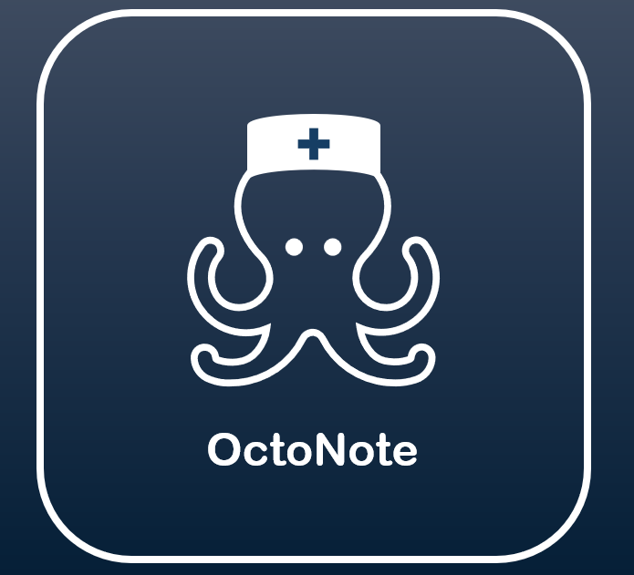

# OctoNote

<p align="center">
  
</p>

OctoNote is an A.I. Clinical Charting Automation Tool. 

Designed to be used simply as an assisted tool to help out hardworking healthcare workers with their charting. Not to replace any human!

It automatically transcribes the audio, then organizing it into a reviewable, editable chart entry. 

The name is inspired by an octopus since it juggles many things at once. Much like a nurse!

I designed the logo myself in PowerPoint! :grin:

## The Inspiration (Why make this?)
I grew up in a family that works in healthcare and tech. My nurse family members have mentioned they are always charting, even having to stay overtime frequently just to finish their notes. They have expressed they wish there was something that could help with this so they can spend more time on patient care.

Well, this had me thinking... Couldn't A.I. do this? I studied machine learning and artificial intelligence in college. So, let me put my skills to the test.

Healthcare workers do a lot already. So this will hopefully alleviate some stress.

My nurse family members do have some hesitation, however. They wonder, "What if it makes mistakes?", "How can we trust it?", "How dependable really is it?", "How do we even regulate this?", "Is it easy to use?".

Essentially, I am using this project to explore this challenge and create a working prototype.


## Project Status
Currently working on this! I will add a demo here when it is ready.

No set deadline so I am taking my time. Since it is just me working on this.

-- Gabriela :relaxed: (10/20/2026)

## Disclaimer
This is not a real clinical tool! All sample data is synthetic.

Also, I am using Claude to help me with project scope and debugging. Basically, it is my assistant. Otherwise this is purely from my own tech brain.


## How Does It Work?
1. **Record Audio** -- Healthcare worker presses record and verbally describes the charting detailed information on the patient.
2. **Transcription** -- The audio is transcribed locally using [faster-whisper](https://github.com/SYSTRAN/faster-whisper).
3. **Structuring** -- The transcript is sent to the **Claude API**, which extracts it into a structured note via a forced tool call built directly from [`schema.json`](schema.json).
4. **Human Review** -- The structured draft is shown so it can be corrected before saving as a final version.
5. **Save** -- The finalized note is stored locally in SQLite.


## Tech Stack
| Layer | Tool |
|---|---|
| Speech-to-Text | faster-whisper (local, open-source) |
| Note Structuring | Claude API (tool use, function calling) |
| Database | SQLite |
| Frontend | HTML / CSS / JavaScript |
| Backend | FastAPI (Python) |

Transcription runs fully locally; structuring is via the Claude API.


## Setup
### First You Will Need
- Python 3.10+
- An Anthropic API key from [console.anthropic.com](https://console.anthropic.com)

### Installation Steps
```bash
git clone https://github.com/<your-username>/voicedoc.git
cd voicedoc
python -m venv venv
source venv/bin/activate  # on Windows: venv\Scripts\activate
pip install -r requirements.txt
cp .env.example .env
# then edit .env and paste in your ANTHROPIC_API_KEY
```

### Running
```bash
# start the backend
uvicorn backend.main:app --reload

# open frontend/index.html in your browser
```


## Project Scope
**Version 1**
- Upload or record audio → transcript
- Transcript → structured JSON note via Claude tool use
- Editable review screen before saving
- Local SQLite storage of past entries

**Future Planned**
- Proper UI (especially user friendly any healthcare can easily use)


## License
MIT — see [LICENSE](LICENSE).